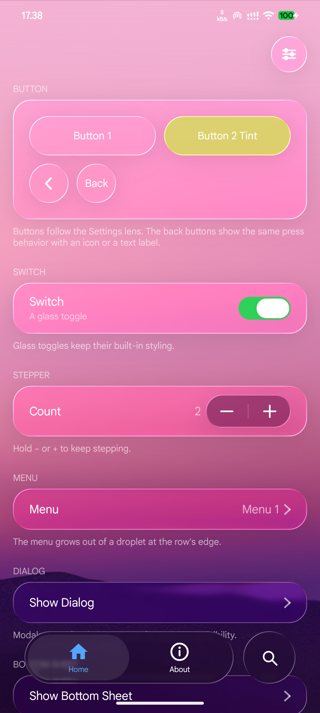
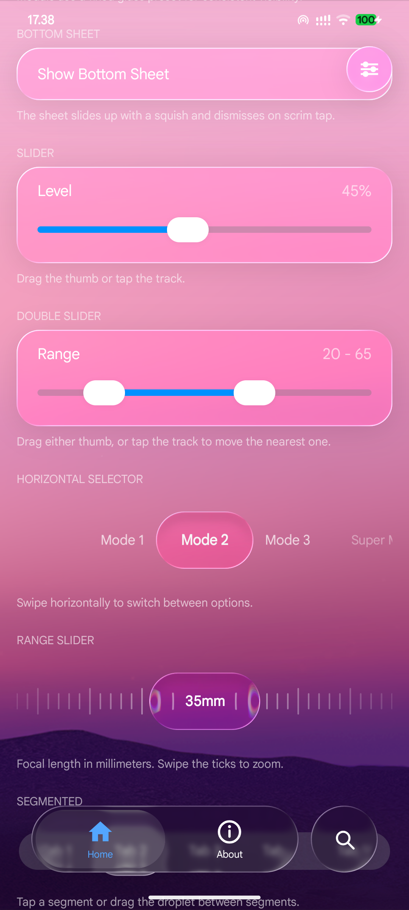
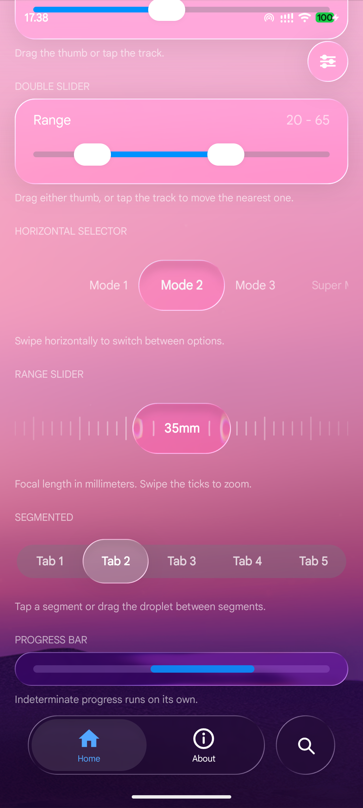
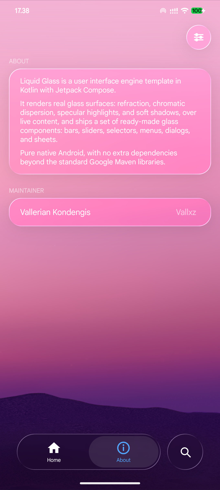
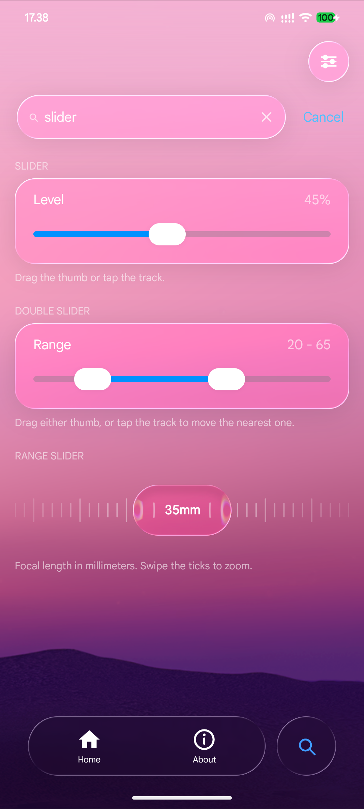
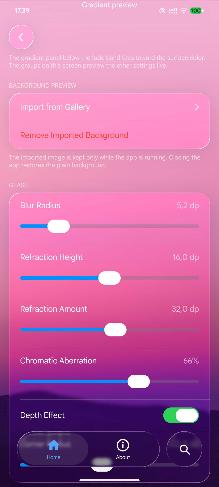
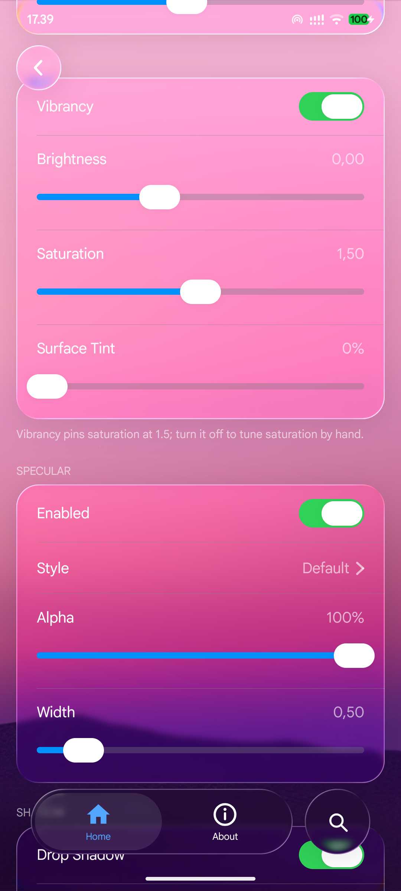
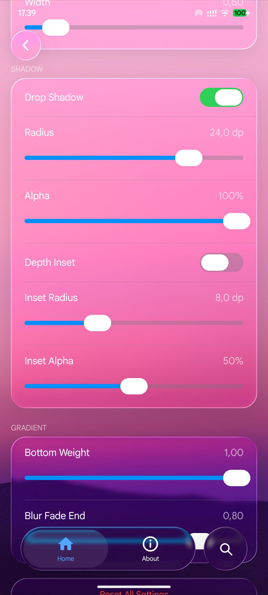
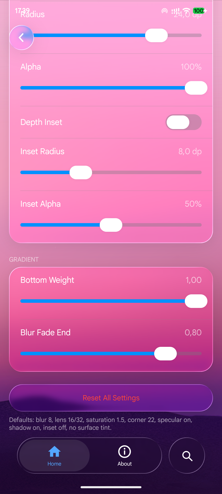
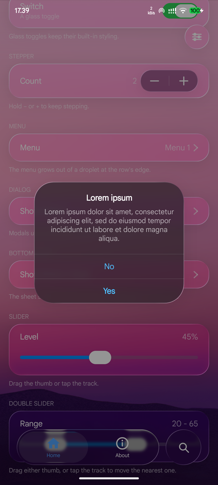

# Liquid Glass

Liquid Glass is a liquid glass UI engine and template for
Jetpack Compose, built in pure Kotlin: backdrop sampling, blur, edge
lens refraction, seven-sample chromatic dispersion, gradient glass,
shader-driven edge highlights, drop and inner shadows, nested and
merged-glass sampling, a shared spring-motion engine, and a complete
component set - using only public Compose and Android graphics APIs.
No third-party glass library, no NDK, no native code.

## Screenshots

<p>
  
  
  
  
  
</p>
<p>
  
  
  
  
  
</p>

## Requirements

- [Eclipse Temurin JDK 25 LTS](https://adoptium.net/temurin/releases/?version=25)
- Android SDK Platform 37.1
- Git

Liquid Glass uses Gradle Wrapper to manage its Gradle version. A separate Gradle installation is not required. No Android Studio is required: the project builds from the command line.

## Development Setup

### 1. Install JDK 25

Download and install Eclipse Temurin JDK 25 LTS from the [official Adoptium website](https://adoptium.net/temurin/releases/?version=25).

Configure `JAVA_HOME` to point to the JDK installation directory and ensure Java is available in your `PATH`.

Verify the installation:

```bash
java -version
javac -version
```

### 2. Configure the Android SDK

Configure the Android SDK and its environment variables by following the [official Android command-line tools documentation](https://developer.android.com/tools).

Install Android SDK Platform 37.1 and the SDK tools required by the project. The project uses API 37.1 for compilation while retaining target SDK 37 and minimum SDK 33.

### 3. Clone the Repository

```bash
git clone https://github.com/valleriankondengis/android-liquid-glass.git
cd android-liquid-glass
```

### 4. Verify the Build Toolchain

Run the following command from a terminal at the project root to verify the configured Gradle and Java versions using the Gradle Wrapper:

```bash
./gradlew --version
```

On Windows, use `gradlew.bat` instead.

### 5. Build the Debug APK

Run the following command from the project root:

```bash
./gradlew :app:assembleDebug
```

On Windows (PowerShell), use `.\gradlew.bat :app:assembleDebug` instead.

The generated APK is located at:

```text
app/build/outputs/apk/debug/app-debug.apk
```

Install it on a connected device with:

```bash
./gradlew :app:installDebug
```

## Project Configuration

| Setting | Value |
|---|---|
| Application language | Kotlin |
| UI Toolkit | Jetpack Compose |
| Android Gradle Plugin | 9.6.0-alpha03 |
| Gradle | 9.8.2 |
| JDK | 25 LTS |
| Kotlin | 2.5.0-RC |
| Compose BOM | 2026.10.01 (`compose-bom-alpha`) |
| kotlinx-coroutines | 1.11.0 |
| Compile SDK | 37.1 (`compileSdk = 37`, `compileSdkMinor = 1`) |
| Minimum SDK | 33 |
| Target SDK | 37 |

## Documentation

- [docs/ARCHITECTURE.md](docs/ARCHITECTURE.md) - how the engine works: backdrops, sampling, the effect chain, shaders, decorations, interaction, and invariants.
- [docs/STRUCTURE.md](docs/STRUCTURE.md) - the file and package map, and where new work goes.
- [docs/COMPONENTS.md](docs/COMPONENTS.md) - the component reference: signatures, behavior, and shared materials.
- [docs/USAGE.md](docs/USAGE.md) - patterns, rules, the forced-edit protocol, and troubleshooting.
- [Agents.md](Agents.md) - instructions for AI agents working in this repository.

## License

This project is licensed under the GNU General Public License v3.0.
See [LICENSE](LICENSE) for the full text.
